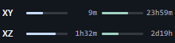
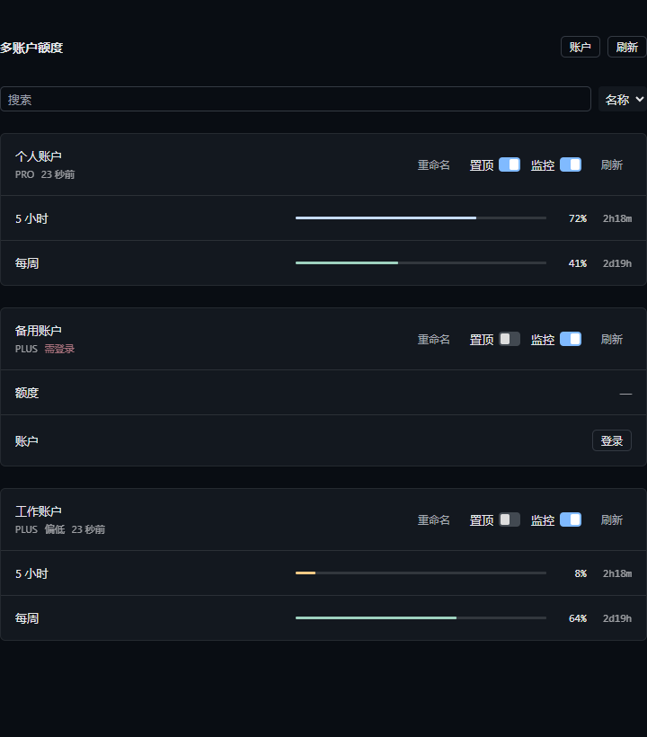

# Quota Dock

Compact multi-account Codex quota monitor for OpenCode Desktop.

在 OpenCode Desktop 左下角查看多个 ChatGPT/Codex 订阅账户的五小时和周额度。

[下载 v0.1.6](https://github.com/PomePerilla/opencode-quota-dock/releases/tag/v0.1.6) · [兼容范围](docs/compatibility.md) · [更新记录](CHANGELOG.md)

## 界面

每个账户独占一行，依次显示账户名、五小时进度条和倒计时、周进度条和倒计时。时间列固定宽度，数字变化时轨道保持对齐。五小时常态色为 `#c5dbfb`。



- 约每 60 秒同步；侧栏收起后暂停定时查询。
- 点击账户刷新，右键打开设置，悬停查看详情。
- 设置页使用 OpenCode 原生布局与控件，支持搜索、排序、重命名、置顶和监控开关。
- 未知读数显示 `—`。

下图为独立交互预览，使用模拟数据；安装后设置控件由 OpenCode 原生渲染。



## 环境

已验证 Windows x64、OpenCode Desktop **2.3.0**、Codex CLI **0.153.4**。安装需要 Node.js **22+**。

当前支持 OpenCode 保存的 **Codex legacy OAuth** 连接，要求认证元数据含可信 `accountID`。新版 **Sign in with ChatGPT** 连接若只有 `clientID`，会显示“暂不支持”。API key 不属于订阅额度监控范围。

左侧栏挂载与额度桥接均为锁定版本的实验集成，详见 [兼容范围](docs/compatibility.md)。

## 安装

### 发布包

从 [Releases](https://github.com/PomePerilla/opencode-quota-dock/releases) 下载 `opencode-quota-dock-0.1.6-source.zip`，该压缩包包含源码、构建产物和安装脚本。解压后在目录中运行：

```powershell
npm ci --omit=dev --ignore-scripts
node scripts/install-local.mjs
```

脚本会登记当前目录为本地插件，并保留现有插件条目；配置备份写入该目录的 `.local/`。保留安装目录。若界面没有自动更新，重启 OpenCode Desktop。

`opencode-quota-dock-0.1.6.tgz` 为标准 npm 运行包，可用于本地依赖安装；本项目尚未发布到 npm registry。

### 从源码安装

```powershell
git clone https://github.com/PomePerilla/opencode-quota-dock.git
cd opencode-quota-dock
npm ci --ignore-scripts
npm run build
node scripts/install-local.mjs
```

如果全局配置使用 JSONC 注释，安装脚本会停止写入。可手动向 `~/.config/opencode/opencode.json` 的 `plugins` 合并该条目，将路径替换为自己的绝对路径：

```json
{
  "plugins": [
    {
      "package": "C:/Tools/opencode-quota-dock"
    }
  ]
}
```

可选配置：`options.codexPath` 指向 Codex 可执行文件的绝对路径。Windows 会自动检测 PATH 和常见 npm 安装位置；不调用 `.cmd`、`.bat` 或 `.ps1` 包装脚本。

卸载时移除这一插件条目。显示偏好位于 `~/.local/state/opencode-quota-dock/`。

## 开发与验证

```powershell
npm ci --ignore-scripts
npm run typecheck
npm test
npm run test:ui
npm run build
npm run preview
```

独立预览：`http://127.0.0.1:4317`；设置页：`http://127.0.0.1:4317/?view=detail`。预览使用模拟数据；原生设置外观需在 OpenCode 中检查。UI 测试使用 Microsoft Edge，可通过 `npx playwright install msedge` 安装测试浏览器。

`npm run doctor` 检查本地环境。`npm run smoke:live` 读取正在运行的 OpenCode 服务，并检查账户身份及激活账户是否保持不变；其成功标准是至少两个兼容账户均 ready。真实服务检查需要当前服务上下文可访问 `openai` 集成。

CI 在 Windows 上执行类型检查、核心测试、界面测试、生产构建与打包。

## 数据处理

- 通过 OpenCode 解析已保存的 OAuth 连接，不激活或切换账户。
- 每次额度读取启动隔离的 Codex App Server，最多两个并发。
- 令牌仅通过子进程 stdin 传入，不放入命令参数、RPC 响应、日志或快照。
- 只读取额度，不发送模型推理请求；不同账户和用量窗口保持独立。
- 不解析新版登录令牌的私有内容，也不猜测账户 ID。

## 打包

```powershell
npm run pack:mvp
```

生成 `artifacts/opencode-quota-dock-0.1.6.tgz`。运行包包括 `dist/`、安装说明、许可证、兼容说明和模拟预览图片。

## License

[MIT](LICENSE)
